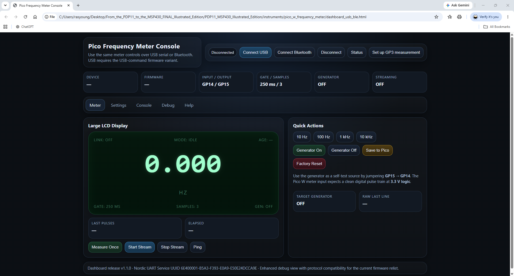

# From the PDP-11 to the MSP430 — revised illustrated textbook

The current reading edition is **From_the_PDP11_to_the_MSP430_Revised_Textbook_CLAUDE.pdf** (144 PDF pages). This independent educational textbook and laboratory companion is not an official DEC, TI, or Analog Devices publication.

## Start here

- `From_the_PDP11_to_the_MSP430_Revised_Textbook_CLAUDE.pdf` — current textbook to read or print.
- `FULL_TEXT_EXPORT.txt` — searchable text extracted from the current PDF. Consult the PDF for figures, tables, and layout.
- `code/msp430/` — candidate firmware and host-tested signal-processing and control logic; see `CCS_PROJECTS.md` for the CCS projects and `BUILD_PLATFORMIO.md` for PlatformIO builds.
- `code/msp430/TEXTBOOK_ADDENDUM.md` — updates to the PDF's printed 1-Wire listing and pointers to the recovered assembly and optional later exercises.
- `code/pdp11/` — PDP-11 assembly example (not assembled in a DEC toolchain here).
- `code/python/` — host analysis and scratchpad calculations.
- `tests/` — host-side regression tests and reproducible command.
- `worksheets/` — blank CSV forms, not experimental results.
- `instruments/pico_w_frequency_meter/` — Pico meter firmware, a USB-command candidate, the BLE dashboard, and an introduction to measuring the MSP430 timer output.
- `validation/` — prior host test output and verification notes; see `REVISION_AUDIT.md` for the current comparison.
- `figures/curriculum_atlas/` — original figure assets; the revised PDF incorporates the instructional plates.
- `00/OLD Versions/` — prior PDFs, editable Word files, and standalone figure atlas as currently organized.

## Pico frequency meter dashboard

The browser dashboard connects to the Pico over USB or Bluetooth and displays frequency, pulse count, and measurement settings. See the [Pico meter guide](instruments/pico_w_frequency_meter/README.md) for firmware setup and the first measurement. The USB path has been tested with simulated devices; physical measurements remain to be verified.

## Source and rebuild status

The revised PDF is the current reading edition. Its editable source and build process were not supplied. `CORE_MANUSCRIPT.md`, `SOURCE_MANUSCRIPT_v1.md`, and the scripts in `editorial/` belong to the earlier edition and cannot reproduce the revised PDF or its layout. The earlier Word file in `00/OLD Versions/` is not an editable version of this revision. Do not treat an output from `editorial/build_final_book.py` as a rebuild of the current book; it also writes `BUILD_NOTES.txt` for the earlier edition. See `validation/REVISION_AUDIT.md`.

## Verification and safety

Host tests exercise Python analysis, 1-Wire CRC and fixed-point decoding, C decoder and hysteresis logic, and a synthetic supervisor. See `validation/HOST_TEST_RESULTS.txt` for the previous complete run and `tests/run_host_tests.sh` for the command. The standalone MSP430 examples and sensor call chain have been compiled for MSP430G2553 with PlatformIO; programming, clocks, Pico counting, 1-Wire timing, real sensor readings, and control outputs remain unverified on hardware. Use 3.3 V logic only, do not connect mains-powered actuators, and check actual pin mappings and voltages before powering. Host tests do not establish electrical or industrial safety.
